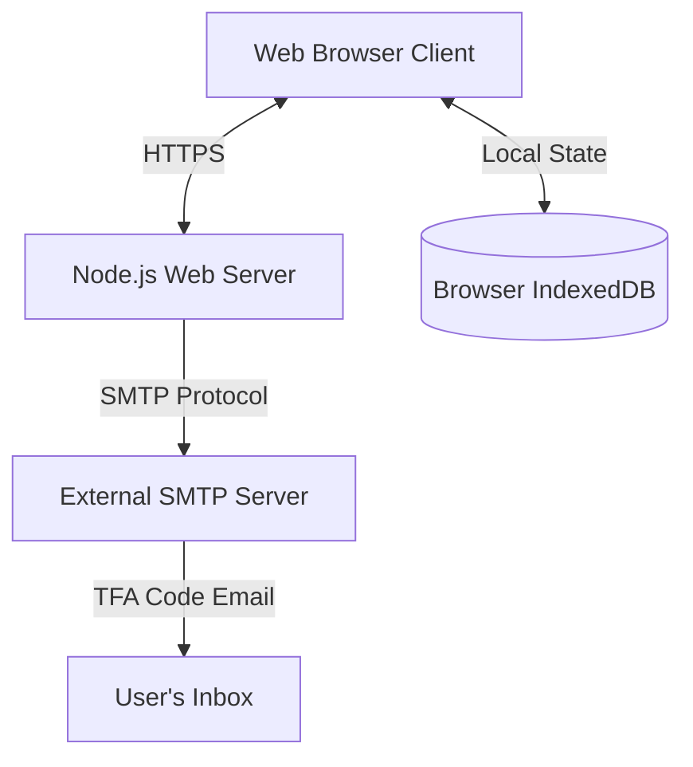

# Technical Documentation - Wennink Family Website

This document provides a comprehensive technical overview of the Wennink Family Website, detailing its architecture, code structure, data schemas, API endpoints, security mechanisms, and deployment guidelines for production environments.

---

## 1. System Architecture

The website is designed as a secure, lightweight **Single Page Application (SPA)** with a Node.js backend acting as a static file server and SMTP mail dispatcher. Client-side state and large databases (such as images, member profiles, and family tree nodes) are managed entirely inside the browser using **IndexedDB**, ensuring offline resilience, speed, and privacy.



### Key Architectural Decisions:
* **IndexedDB for Storage:** Storing high-resolution photos, member details, and family tree structures inside IndexedDB reduces backend database overhead and keeps hosting costs minimal, while allowing the Admin to export/import the entire dataset as a single JSON file.
* **SMTP Decoupling:** The Node.js server does not maintain SMTP credentials. SMTP settings are configured securely in the Admin Panel, stored in the client's local IndexedDB, and sent dynamically to the server per email dispatch request.
* **Bilingual Support:** Interface components and page templates translate dynamically on the client side using a lookup matrix, retaining the user's selected language in `localStorage`.

---

## 2. Technology Stack

### Frontend (Client-Side)
* **HTML5 & CSS3:** Semantic markup and styling utilizing CSS Custom Properties (Variables) for dynamic color theme adjustments. Relies on a responsive layout grid with glassmorphic pastel design patterns.
* **JavaScript (ES6 Modules):** Modular components, dynamic event listeners, and SPA tab-routing.
* **D3.js (v7):** Implements the interactive, zoomable, and collapsible Family Tree SVG layout.
* **Mammoth.js (v1.11.0):** Reads and parses uploaded `.docx` history files into clean, styled HTML client-side.
* **Heic2any (v0.0.4):** Handles on-the-fly client-side conversion of Apple HEIC/HEIF images to JPEG before storage.

### Backend (Server-Side)
* **Node.js Runtime (v14+):** Low-overhead HTTP server built using core modules (`http`, `fs`, `path`).
* **Nodemailer:** The only external production dependency, used for dynamic SMTP mail transport during 2FA code verification.

---

## 3. Directory & File Structure

The project root directory is organized as follows:

```
├── index.html            # Main HTML layout, modals, and container structures
├── style.css             # Main stylesheet, theme tokens, and component layouts
├── app.js                # Client coordinator (routing, events, page render engines)
├── db.js                 # IndexedDB database management (schema, migrations, CRUD hooks)
├── auth.js               # Client access controls, session state, lockouts, and TFA logic
├── tree.js               # D3.js family tree rendering, node cards, and links layout
├── translations.js       # Dutch (NL) and English (EN) localization lookup matrices
├── server.js             # Zero-dependency Node.js web server and TFA email endpoint
├── package.json          # Node project manifest (scripts & dependencies)
└── package-lock.json     # Node lockfile
```

---

## 4. Database Schema (IndexedDB)

The database is initialized under the name `WenninkDB`. Version `3` contains five primary object stores:

```
Database: WenninkDB (v3)
 ├── settings
 ├── members
 ├── reunions
 ├── treeNodes
 └── albums
```

### 4.1. `settings` Store
Stores global configuration values. Key-value based.
* **Keys:**
  * `primaryColor` / `secondaryColor` / `headerColor` / `textColor`: Hex strings for theme colors.
  * `bodyFont` / `headerFont`: String font-family values (e.g. `'Outfit'`, `'Playfair Display'`).
  * `bodyFontSize`: Base font size (e.g., `'16px'`).
  * `familyCrest`: Base64 string or inline SVG of the family crest.
  * `familyPhoto`: Base64 string of the home banner image.
  * `lastUpdated`: ISO-8601 timestamp string representing the last database modification.
  * `smtpHost` / `smtpPort` / `smtpSecure` / `smtpUser` / `smtpPass` / `smtpFrom`: Individual configuration settings for email dispatch.
  * `admin_custom_password` / `user_custom_password`: Settings-backed custom passwords for default admin and user credentials.
  * `userGuideNl` / `userGuideEn`: Text configurations for the help guidelines.
  * `historyNl` / `historyEn`: Text configurations for the homepage history card.
  * `historyDocs`: Array of objects storing uploaded history files:
    ```typescript
    interface HistoryDoc {
      name: string;      // Filename
      type: 'docx'|'pdf';// File format
      content: string;   // Base64 string (PDF) or raw mammoth HTML string (DOCX)
      timestamp: number; // Upload date
    }
    ```

### 4.2. `members` Store
Holds profile details of family members.
* **Structure:**
  ```typescript
  interface FamilyMember {
    id: number;              // Auto-incrementing primary key
    firstname: string;       // Required
    insertion?: string;      // Optional (e.g., "van", "de")
    lastname: string;        // Required
    gender?: 'man'|'vrouw'|'anders'; // Optional gender selection
    email?: string;          // Optional
    password?: string;       // Optional (password for dynamische users)
    mobile?: string;         // Optional
    landline?: string;       // Optional
    address1?: string;       // Optional
    address2?: string;       // Optional
    zip?: string;            // Optional
    city?: string;           // Optional
    state?: string;          // Optional
    country?: string;        // Optional
    birthYear?: string;      // Day-Month-Year date or YYYY string
    deathYear?: string;      // Day-Month-Year date or YYYY string (deceased if present)
    availableForTree: boolean;// Flag indicating availability for tree connection
  }
  ```

### 4.3. `reunions` Store
Chronological timeline of reunions and their associated galleries.
* **Structure:**
  ```typescript
  interface Reunion {
    id: number;              // Auto-incrementing primary key
    title: string;           // Reunion title
    description: string;     // Text description
    date: string;            // Event date (YYYY-MM-DD)
    location: string;        // Location name
    photos: Array<{          // List of compressed gallery images
      id: string;            // Unique photo uuid/timestamp
      src: string;           // Base64 data URL
      name: string;          // Original filename
    }>;
  }
  ```

### 4.4. `treeNodes` Store
Specifies the family tree nodes hierarchical data parsed by D3.js.
* **Structure:**
  ```typescript
  interface TreeNode {
    id: number;              // Maps 1-to-1 with a directory Member ID
    name: string;            // Display name
    birthYear?: string;      // Birth year or date
    deathYear?: string;      // Death year or date
    parentId?: number;       // Parent node ID (bloodline link)
    partnerId?: number;      // Spouse node ID (marital link)
    isPartner: boolean;      // True if node is connected via marriage
    spouse?: string;         // String name of the spouse (for backward compatibility)
  }
  ```

### 4.5. `albums` Store
Independent custom photo albums.
* **Structure:**
  ```typescript
  interface Album {
    id: number;              // Auto-incrementing primary key
    name: string;            // Unique album name
    coverPhotoId?: string;   // Image ID representing the album thumbnail
    photos: Array<{
      id: string;            // Unique photo uuid/timestamp
      src: string;           // Base64 data URL
      name: string;          // Original filename
    }>;
  }
  ```

---

## 5. API Endpoints

The backend provides a single operational JSON API endpoint. All other requests serve static assets.

### `POST /api/send-tfa`
Transports simulated 2FA verification codes to client emails using the admin's custom SMTP configuration.

* **Headers:** `Content-Type: application/json`
* **Request Payload:**
  ```json
  {
    "to": "user@email.com",
    "code": "12345",
    "smtpConfig": {
      "host": "smtp.mailtrap.io",
      "port": 587,
      "secure": false,
      "user": "smtp_username",
      "pass": "smtp_password",
      "from": "\"Wennink Family Site\" <no-reply@wennink.nl>"
    }
  }
  ```
* **Success Response (200 OK):**
  ```json
  {
    "success": true,
    "messageId": "<message-uuid@smtp-provider>"
  }
  ```
* **Error Response (400 Bad Request / 500 Internal Error):**
  ```json
  {
    "success": false,
    "error": "Error description string"
  }
  ```

---

## 6. Security Implementation

### 6.1. Client-Side Authentication Flow
* **Role separation:** The application supports two roles: `Admin` (writes, edits data, configures theme/SMTP) and `User` (read-only access, views tree/reunions/member list).
* **Credentials:** Logins are verified inside `auth.js` against dynamic credentials in IndexedDB `members` store, settings-backed custom passwords, or fallback hardcoded default credentials.
* **Session Management:** Successful login sets a browser session payload (`wennink_session_user`) in `sessionStorage` which is validated on tab transitions, API interactions, and page reloads.

### 6.2. Two-Factor Authentication (2FA) & Lockout
* **2FA Code Delivery:** Generates a random 5-digit verification code. If SMTP settings are configured, it invokes `POST /api/send-tfa`. If delivery fails or is unconfigured, the code is outputted in a top-screen banner for demo/fallback verification.
* **Trusted Browsers:** Checking the "Remember this browser" option sets a key (`trustedBrowser_${email}`) in `localStorage` which bypasses the 2FA step for subsequent logins on that browser.
* **Brute-Force Lockout:** Tracks failed login attempts in-memory *per email address*. Upon 3 consecutive failures, the account is locked out and the user is redirected to the password reset form. Any subsequent login attempts for a locked-out email are blocked immediately until the password is reset.

### 6.3. User Invitation & Password Reset Flows
* **User Invitation:** The Admin can trigger an invitation email to a new member from the contact details popup inside the **Familieleden** (Members) tab. The email contains a link formatted as `?invite=email`.
* **Password Recovery:** Users can click the **Wachtwoord vergeten?** (Forgot password) link on the login modal to request a password recovery email containing a link formatted as `?reset=email`.
* **URL Parameter Processing:** On page load, `checkUrlQueryParams()` detects these parameters, cleans the address bar immediately via `window.history.replaceState` (to prevent duplicate modal triggers on refresh), and displays the **Wachtwoord Instellen** (Set Password) modal.
* **Auto-Login:** Saving the password updates the password in IndexedDB (or settings for default users), resets the failed attempts lockout, logs the user in automatically, and redirects them to the home page.

### 6.4. Server Security (Path Traversal Guard)
To prevent attackers from traversing directories using URLs like `/../../etc/passwd`, the server normalizes paths using Node's `path.resolve` and checks prefix validation:
```javascript
const absolutePath = path.resolve(__dirname, filePath);
if (!absolutePath.startsWith(__dirname)) {
  res.statusCode = 403;
  res.end('Access Denied');
  return;
}
```

---

## 7. Hosting & Production Deployment

The application is dual-compatible and can be deployed in either of the following production hosting setups:
1. **Standard PHP/Apache Shared Hosting (via FTP)**: Serves static assets directly; calls `.htaccess` and `api/send-tfa.php` to handle email dispatches. (Recommended for typical shared web domains like `www.wennink.eu`).
2. **Node.js Dedicated Server (VPS)**: Uses PM2 and Nginx as a reverse proxy, executing `server.js` on port `3000` or the environment's `process.env.PORT`.

---

### 7.1. Option A: PHP/Apache Shared Hosting (FTP Transfer)
This is the simplest deployment method for typical shared hosting providers.

#### Step 1: Prepare Files
Ensure the following files are present in the directory:
* `.htaccess` (contains rewrite rules to map `/api/send-tfa` to `/api/send-tfa.php`)
* `api/send-tfa.php` (contains the PHP socket-based SMTP email sender)
* All core frontend assets (`index.html`, `style.css`, `app.js`, `db.js`, `auth.js`, `tree.js`, `translations.js`)

#### Step 2: Transfer via FTP
1. Connect to your host (`www.wennink.eu`) using an FTP client (e.g., FileZilla).
2. Navigate to your web root folder (usually `public_html`, `httpdocs`, or `www`).
3. Upload all files and folders (including the `api` folder and the `.htaccess` file) from your local project directory directly into that web root folder.

#### Step 3: HTTPS & SSL
Verify in your hosting provider's dashboard (e.g., cPanel, Plesk, or hosting panel) that **SSL/TLS (Let's Encrypt)** is active for `www.wennink.eu`. The website should load over secure `https://www.wennink.eu`.

---

### 7.2. Option B: Node.js VPS Server
Use this method if you have root access to a VPS and want to run the application using Node.js.

#### Step 1: Server Prerequisites
* **Operating System:** Linux (Ubuntu 20.04 LTS or newer recommended) or macOS.
* **Runtime:** Node.js v14 or higher.
* **Network:** Ports `80` (HTTP) and `443` (HTTPS) open on the firewall.
* **Domain Name:** A domain pointed to the server's public IP.

#### Step 2: Upload and Install
1. Clone or upload the project files to the target folder (e.g. `/var/www/wennink-website`).
2. Install production dependencies (Nodemailer for mail transport):
   ```bash
   npm install --production
   ```

#### Step 3: PM2 Process Manager
Keep `server.js` running in the background and surviving crashes:
```bash
sudo npm install -g pm2
pm2 start server.js --name "wennink-family-site"
pm2 startup
pm2 save
```

#### Step 4: Reverse Proxy Configuration (Nginx)
Configure Nginx as a reverse proxy (e.g. in `/etc/nginx/sites-available/wennink-site`):
```nginx
server {
    listen 80;
    server_name wennink.eu www.wennink.eu;

    location / {
        proxy_pass http://127.0.0.1:3000;
        proxy_http_version 1.1;
        proxy_set_header Upgrade $http_upgrade;
        proxy_set_header Connection 'upgrade';
        proxy_set_header Host $host;
        proxy_cache_bypass $http_upgrade;
        proxy_set_header X-Real-IP $remote_addr;
        proxy_set_header X-Forwarded-For $proxy_add_x_forwarded_for;
        proxy_set_header X-Forwarded-Proto $scheme;
    }

    client_max_body_size 20M;
}
```
Enable the configuration and reload Nginx:
```bash
sudo ln -s /etc/nginx/sites-available/wennink-site /etc/nginx/sites-enabled/
sudo systemctl restart nginx
```

#### Step 5: Secure with SSL via Let's Encrypt
Run Certbot to automate SSL certificate acquisition and configure automatic redirections to HTTPS:
```bash
sudo apt install certbot python3-certbot-nginx
sudo certbot --nginx -d wennink.eu -d www.wennink.eu
```

---

### 7.3. Recommended Security & Hosting Advice
* **Database Backups:** Advise the Admin to download database backups frequently using the "Exporteer Database" button in the Admin tab and store them in a secure cloud storage location.
* **Firewall Isolation:** If running a Node.js VPS, block public access to port `3000` via UFW. Only ports `80`, `443` (handled by Nginx), and SSH port `22` should be open.
  ```bash
  sudo ufw default deny incoming
  sudo ufw default allow outgoing
  sudo ufw allow ssh
  sudo ufw allow 'Nginx Full'
  sudo ufw enable
  ```
* **Node Environment:** When deploying to production, run the PM2 process with `NODE_ENV=production` configured.
